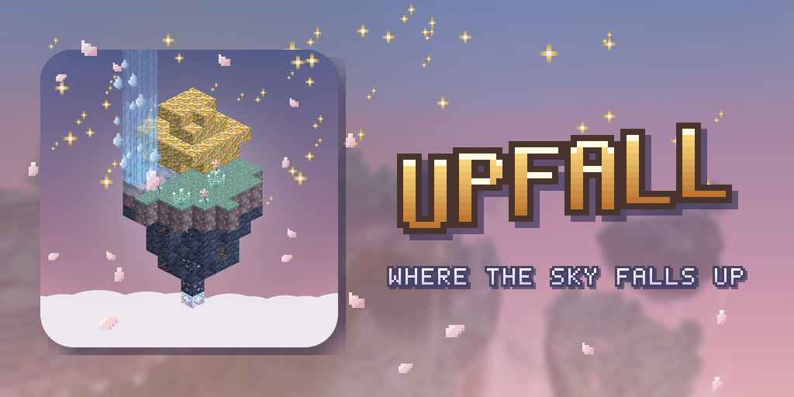
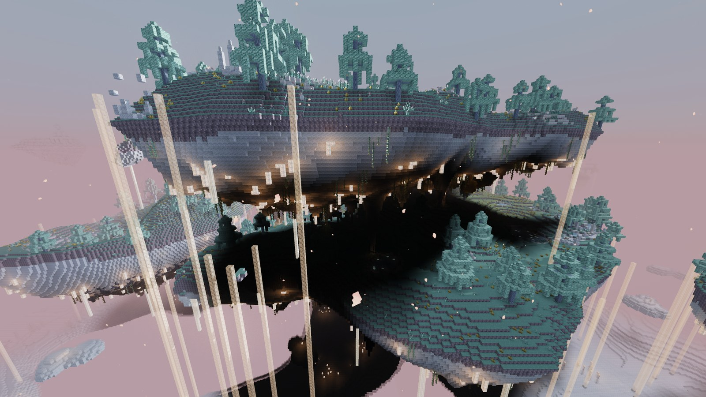
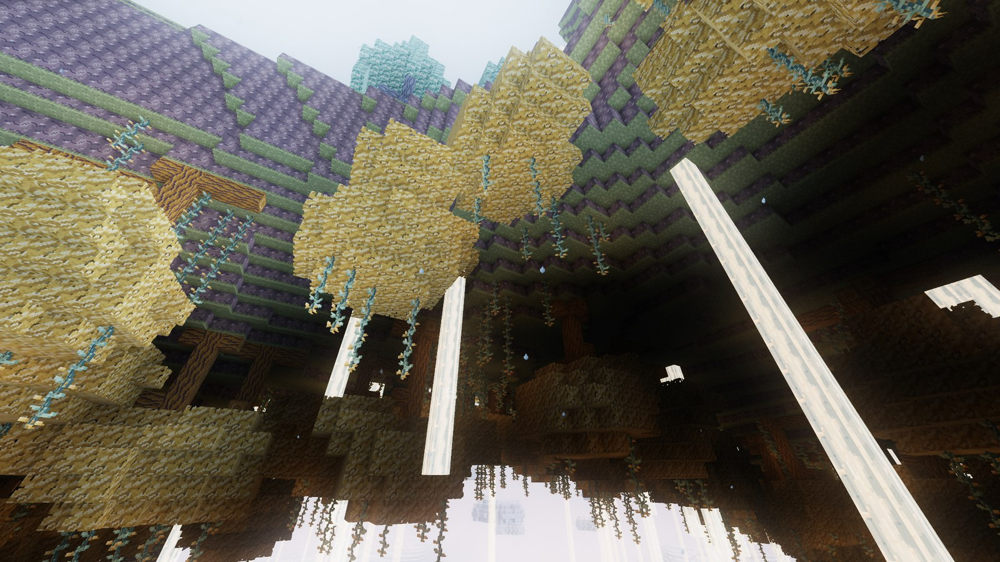
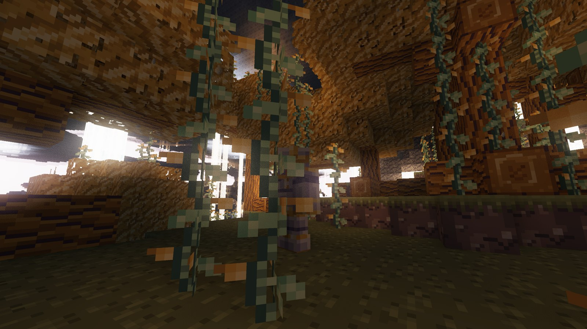
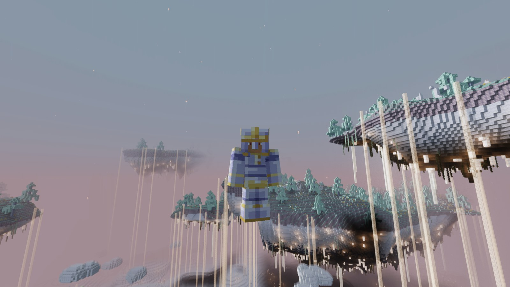
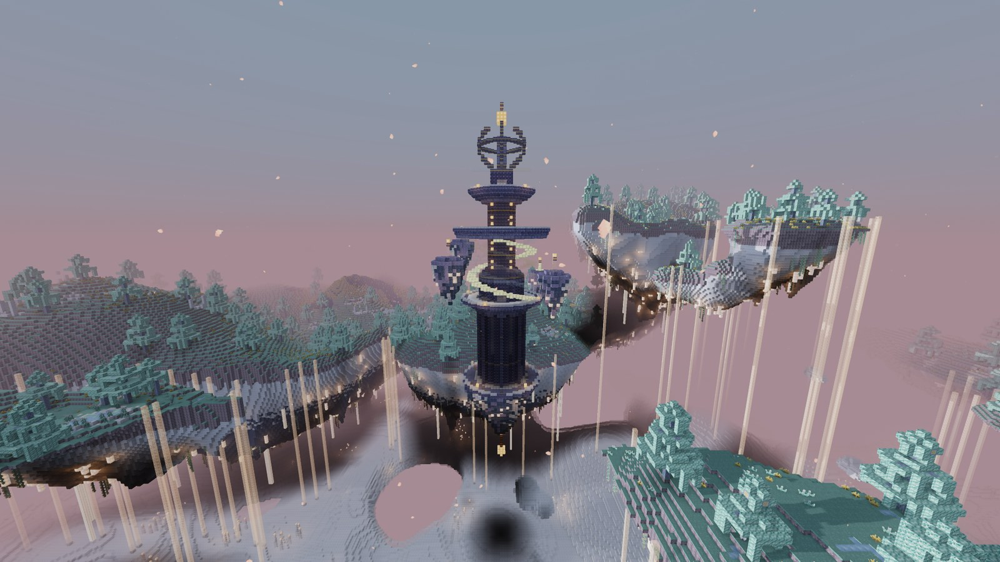
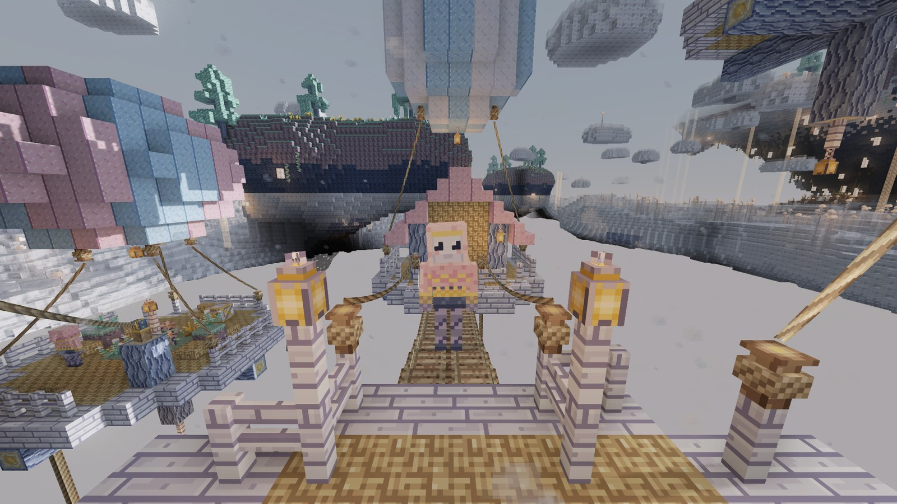
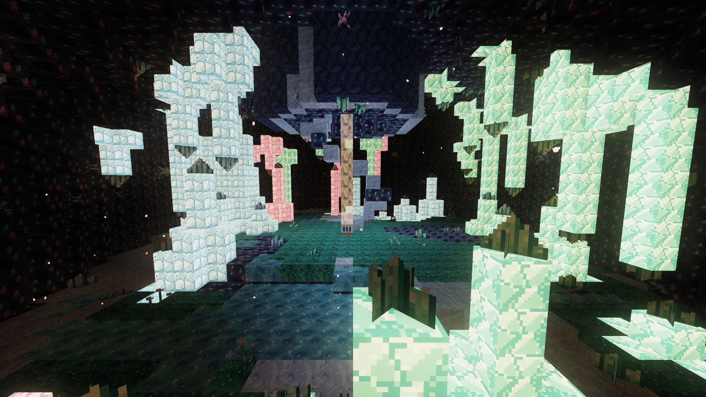
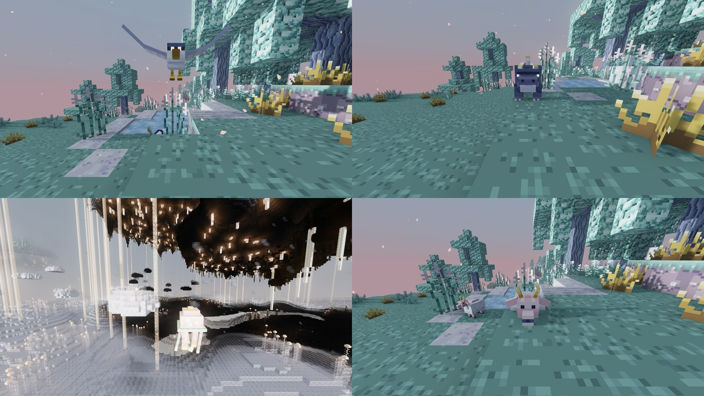

<b>An endgame sky dimension for Minecraft 1.21.1 (NeoForge) where gravity is a place, not a rule.</b>

---

## Upfall

Most sky dimensions are islands floating over nothing. Upfall starts from a different question: *what if falling did
not always mean down?*

**The Upfall** is a world stuck in the last golden hour of the day. Archipelagos drift above a sea of condensed clouds,
whole islands hang upside down with their forests pointing at the abyss, and waterfalls pour **upward** into the rock.
Gravity changes from one place to the next, and learning where it bends is how you get around: ride updrafts,
walk on the underside of islands, sink through rising cascades, double jump between floating ruins.

It is built as an **endgame** destination. You reach it after the Wither and the End, arrive in netherite, and leave with
two new gear tiers, new enchantments and a few stories about the time you fell up.

---

## At a glance

### A dimension above the clouds

Four biomes share the sky: the **Drifting Archipelago** with its Skyreach forests and Skywater lakes, the open
**Mistsea**, the **Hanging Roots** where islands grow upside down, and the rare gold-veined **Gilded Ridge**, the only
source of Levitite.

Below the islands lies the **cloud sea**: Dense Cloud you can walk on, Mist you can wade through (it blinds and slows
you), pearled clouds to mine and, deeper down, the abyss and its glowing stone needles. Falling out of the world is not
death: the sky lets you go and you land back in the Overworld under Slow Falling.

### Gravity that bends

| | |
|---|---|
|  |  |
| **Weightless**: under an inverted island, gravity flips and you walk on its underside. | **Levitite set**: double jump, glide and no fall damage. |

**Updraft Vents** lift you through columns of rising mist toward higher islands, and **Upfall Cascades** are waterfalls
flowing upward, slow enough to swim through.

### Structures

| | |
|---|---|
|  |  |
| **Chronospire**: a floating clock tower that changes shape with the time of day, with moving platforms and two puzzles guarding its vault. | **Cloud Hamlet**: platforms tethered to balloons above the cloud sea, joined by rope bridges and ziplines, home of the Loftkin who barter sky goods. |

The **Crystal Grotto** is a geode hanging under the cloud sea, lit by luminescent crystals. **Drifting Ruins** and
**Inverted Observatories** hold the smithing templates.

### Creatures

**Duskwing**, a raptor that dives at its prey; **Cragmaw**, a leaping island predator; **Mistjelly**, drifting in the
cloud sea and stinging when provoked; **Skygrazer**, a herd animal you can breed. The **Skyray**, a manta ray gliding
between the islands, completes the sky.

---

## Getting there

1. Craft **Halo Frames** (Netherite Ingot, Purpur Blocks, Light Blue Stained Glass; makes 8).
2. Craft a **Skyward Key** (Nether Star, Elytra, Feathers).
3. Climb **above Y 200 in the Overworld**: the key only resonates high in the sky.
4. Build a frame like a Nether portal (4x5 up to 23x23) and use the key on it.

The return portal is always built on an island, never above the void. Portals link like Nether portals, at a 1:1 scale.

---

## Progression

### Tier 1: Nimbusite

* **Nimbusite Ore** is common in islands between Y 90 and 200 and needs a **netherite pickaxe**.
* The **Nimbusite Upgrade Smithing Template** is found in the Sky Caches of the **Drifting Ruins**.
* Smithing: template + netherite piece + Nimbusite Ingot.
* **Full set bonus**: fall damage reduced by 75%.

### Tier 2: Levitite

* **Levitite Ore** only exists in the **Gilded Ridge** and needs a **Nimbusite pickaxe**. It drops Levitite Shards.
* **Levitite Ingot** = 4 Levitite Shards + 4 Nimbusite Ingots.
* The **Levitite Upgrade Smithing Template** is guaranteed in the **Inverted Observatories** and can also be found in the
  Chronospire vault.
* Smithing: template + Nimbusite piece + Levitite Ingot.
* **Full set bonus**: no fall damage, double jump (press jump in mid-air) and glide (hold jump while falling).

Set bonuses are listed in each armor piece's tooltip. The **Upfall** advancement tab follows the whole path.

| | Netherite | Nimbusite | Levitite |
|---|---|---|---|
| Tool durability | 2031 | **2400** | **3000** |
| Mining speed | 9 | **10** | **11** |
| Sword / axe / pickaxe damage | 8 / 10 / 6 | **9 / 11 / 7** | **10 / 12 / 8** |
| Enchantability | 15 | 16 | 18 |
| Armor (helmet / chest / legs / boots) | 3 / 8 / 6 / 3 | 3 / 8 / **7** / 3 | **4 / 9 / 7 / 4** |
| Armor toughness | 3 | **3.5** | **4** |
| Knockback resistance (per piece) | 0.1 | **0.125** | **0.15** |
| Full set bonus | none | -75% fall damage | no fall damage, double jump, glide |

### Enchantments

| Enchantment | Slot | Effect |
|---|---|---|
| **Skywalker** I-III | Boots | Much faster movement inside Mist. |
| **Uplifted** I-III | Chestplate | Faster rise in updrafts. |
| **Cloudsight** I | Helmet | No fog and no slowdown inside Mist. |
| **Jumpstart** I-III | Levitite Boots only | Jump higher and further. |

---

## Notable items and crafts

All recipes are in the recipe book. A few worth knowing:

| Item | How |
|---|---|
| **Updraft Compass** | Points to the nearest Updraft Vent. Dense Cloud, Compass, Nimbusite Ingot. |
| **Updraft Vent** | Place it to create your own updraft column. Polished Pearlstone, Dense Cloud, Nimbusite Ingot. |
| **Nimbus Flask** | Condenses a temporary cloud platform under you: the emergency exit when you fall. Glass Bottle, Cloud Pearls, Dense Cloud. |
| **Zipline Handle** and **Rope** | Ride the ziplines of the Cloud Hamlets, or tie your own lines between Rope Anchors and Zipline Anchors. |
| **Rewinding Hourglass** | Unique reward of the Chronospire. Takes you back to where you last stood on solid ground. |
| **Mistglow Lantern** | Crafted from Mistglow Dust, which drops from Mistglow Crystals like glowstone. |
| **Cloud Lamp** | 4 Cloud Pearls (mined from Pearled Cloud) around Dense Cloud. |
| **Cloudberry Tart**, **Cloudberry Jelly**, **Gildfruit** | Sky food; some of it makes you Weightless for a moment. |
| **Mob drops** | Duskwing Plumes (arrows, Slow Falling), Cragmaw Fangs (Strength), Mist Gel (Invisibility), Down Tufts (wool). |

Building blocks: Pearlstone, Duskslate and Lumen families, Skyreach and Gildroot wood sets, crystals in three colors,
Dense Cloud, Cloud Lamps and more.

---

## Built with

* [NeoForge](https://neoforged.net/) 21.1 and [ModDevGradle](https://github.com/neoforged/ModDevGradle)
* [Parchment](https://parchmentmc.org/) mappings
* Java 21 and Gradle
* NeoForge **data generators** for every model, loot table, recipe, tag, advancement and the whole worldgen
  (dimension, density functions, biomes, features, structures, enchantments)
* Minecraft's **GameTest** framework for the gameplay tests
* Paint.NET for **all the (visuals) assets** (if you're good at pixel art, i'd love to work you you! My textures are a bit ... rough)

## License

Upfall is licensed under the [GNU Lesser General Public License v3.0](LICENSE) (see also [COPYING](COPYING) for the
GNU GPL v3.0 it builds upon).
