

<b>Endgame sky dimension for Minecraft 1.21.1 and 26.1.2 (NeoForge).</b>

---

Upfall adds a dimension of floating islands above a cloud sea, stuck at dusk. Gravity changes from place to place:
updrafts, upward waterfalls, inverted islands you can walk under. It is meant to be reached after the Wither and the
End, and adds two gear tiers past netherite, machines, structures with puzzles and a boss.

Recipes show up in JEI (both versions) and EMI (1.21.1) when installed. English and French.

## In-game guide

Install [GuideME](https://modrinth.com/mod/guideme) (optional) to get the **Sky Almanac**, a book covering
progression, biomes, creatures, structures, materials, machines and blocks.

* You get one the first time you join a world.
* Lost it? Craft another one from a Book and a Feather.
* Right-click it to open the guide.

Without GuideME the mod works the same, there is just no in-game guide.

## Getting there

1. Craft **Halo Frames** (Netherite Ingot, Purpur Blocks, Light Blue Stained Glass; makes 8).
2. Craft a **Skyward Key** (Nether Star, Elytra, Feathers).
3. Build a frame like a Nether portal (4x5 up to 23x23) **above Y 200 in the Overworld** and use the key on it.

The return portal is always built on an island. Falling into the void sends you back above the Overworld with Slow
Falling.

## Biomes

| | |
|---|---|
| 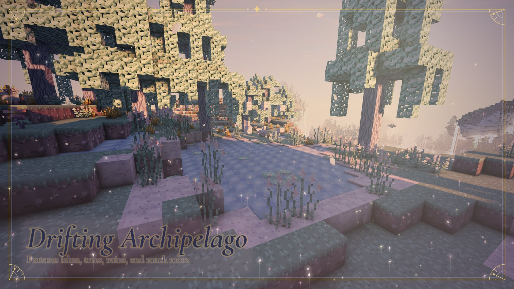 |  |
| **Drifting Archipelago**: two layers of islands, Skyreach forests, Skywater lakes. | **Hanging Roots**: upside-down islands. Stand under one and gravity flips. |
| 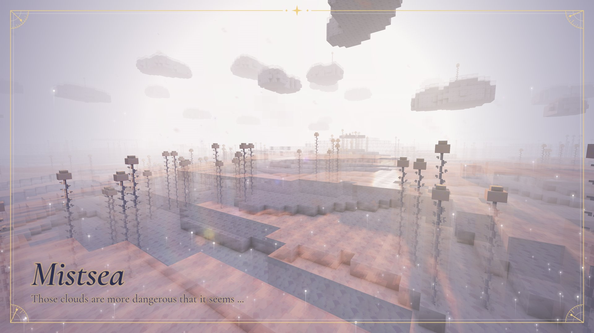 | 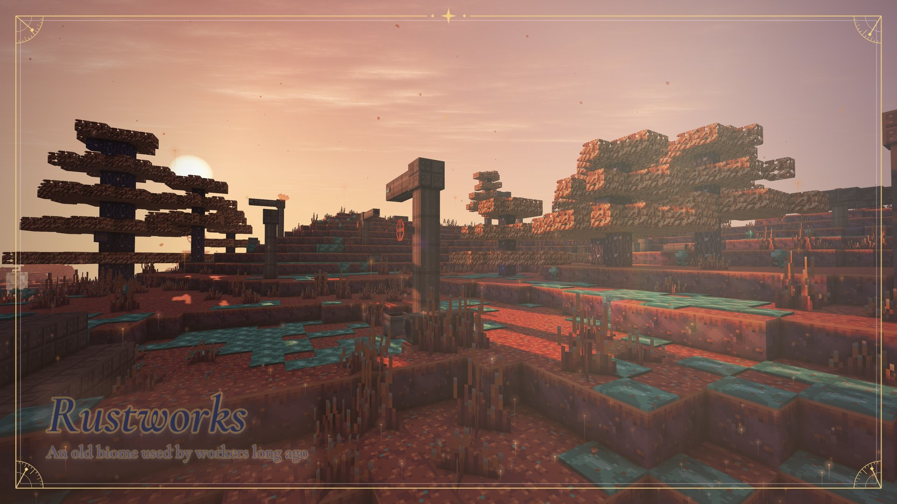 |
| **Mistsea**: open cloud sea. Dense Cloud holds you up, Mist blinds and slows. | **Rustworks**: rusted islands linked by giant pipes, Ironbark trees, steam vents. Source of Kairite. |

The rare **Gilded Ridge** is the only source of Levitite.

Across the dimension: **Updraft Vents** lift you to higher islands, **Upfall Cascades** flow upward, and **gas caves**
inside the islands are filled with Veil Gas, an invisible gas that hurts without a mask.

## Structures

| | |
|---|---|
| 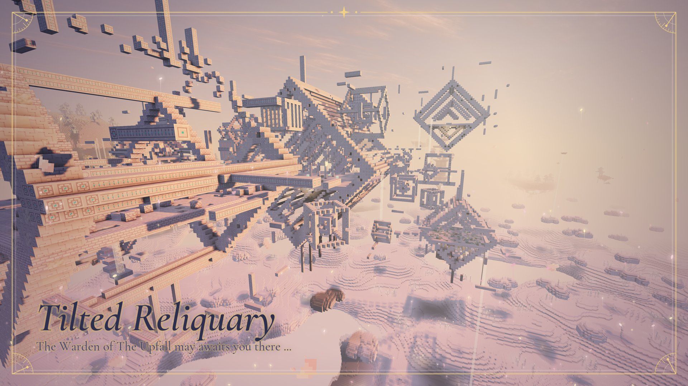 |  |
| **Tilted Reliquary**: very rare cluster of tilted lattice cubes above the cloud sea. Find four Fold Shards in the satellite cubes to open the core, where the Fold Warden sleeps. | **Chronospire**: clock tower that changes shape with the Overworld time. Moving platforms, two puzzles, the Rewinding Hourglass. |
| 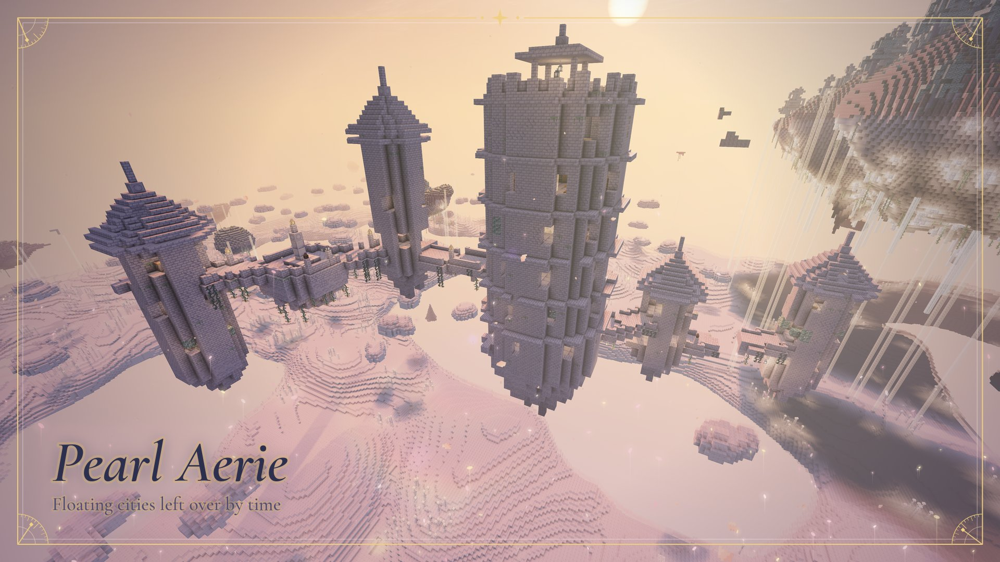 | 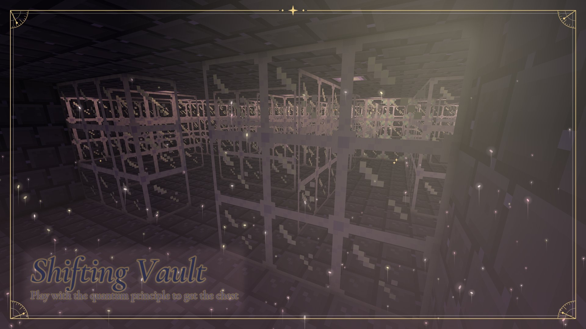 |
| **Pearl Aerie**: abandoned towers linked by bridges. Crumbling floors, arrow traps, spawners, and the Gravity Sceptre in the keep. | **Shifting Vault**: buried glass maze. Its chest moves whenever you look away. Holds the Quantum Pedestal blueprint. |
| 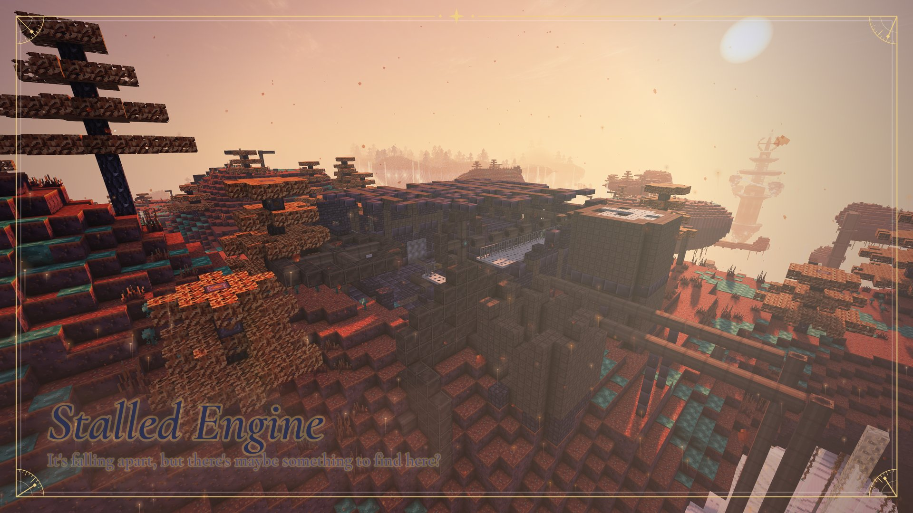 | 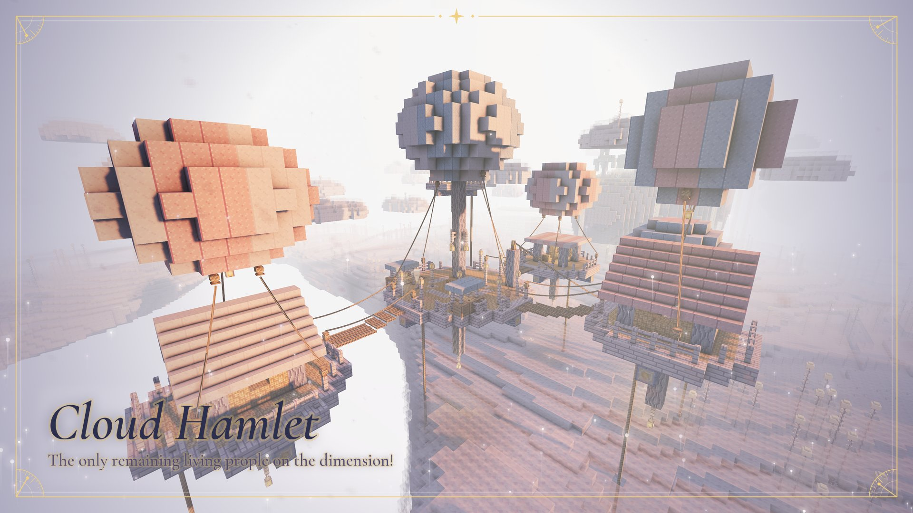 |
| **Stalled Engine**: ruined pump hall in the Rustworks. Machine blueprints, and a flooded vault to drain with three valves. | **Cloud Hamlet**: balloon-tethered platforms with rope bridges and ziplines. Loftkin traders live here. |
| 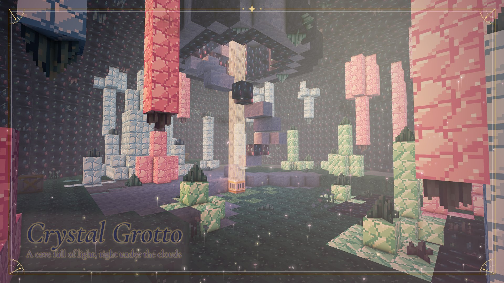 | |
| **Crystal Grotto**: geode hanging under the cloud sea. | |

**Drifting Ruins** and **Inverted Observatories** hold the Nimbusite and Levitite smithing templates.

## Mobs

| | |
|---|---|
| 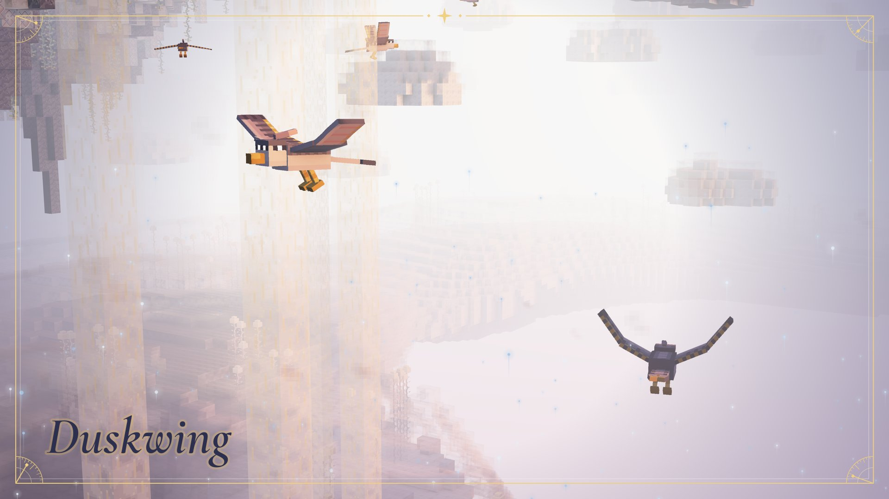 | 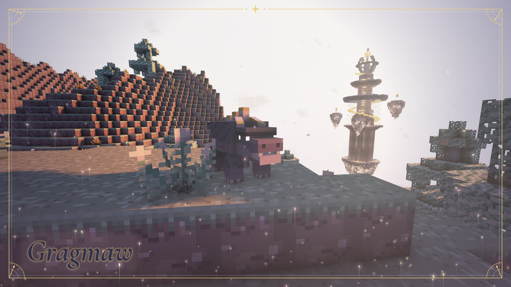 |
| **Duskwing**: hostile raptor, dives at you from above. | **Cragmaw**: hostile, leaps across islands. |
| 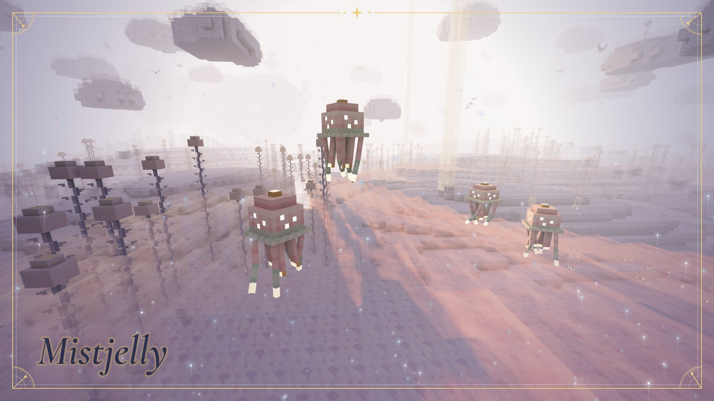 | 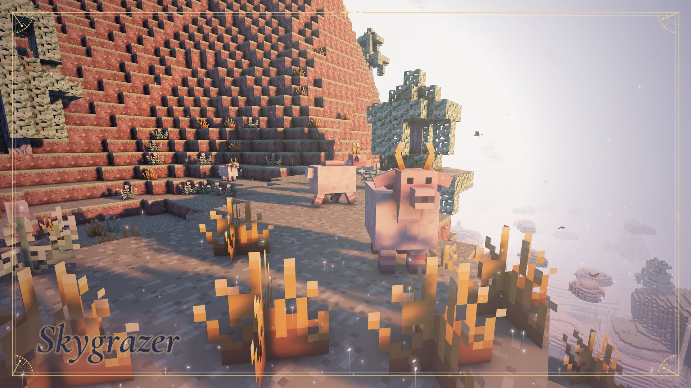 |
| **Mistjelly**: drifts in the cloud sea, stings when hit. | **Skygrazer**: passive herd animal, breedable. |

Also: **Loftkin** (traders of the Cloud Hamlets) and **Skyray** (passive manta ray).

## Boss: the Fold Warden

| | |
|---|---|
| 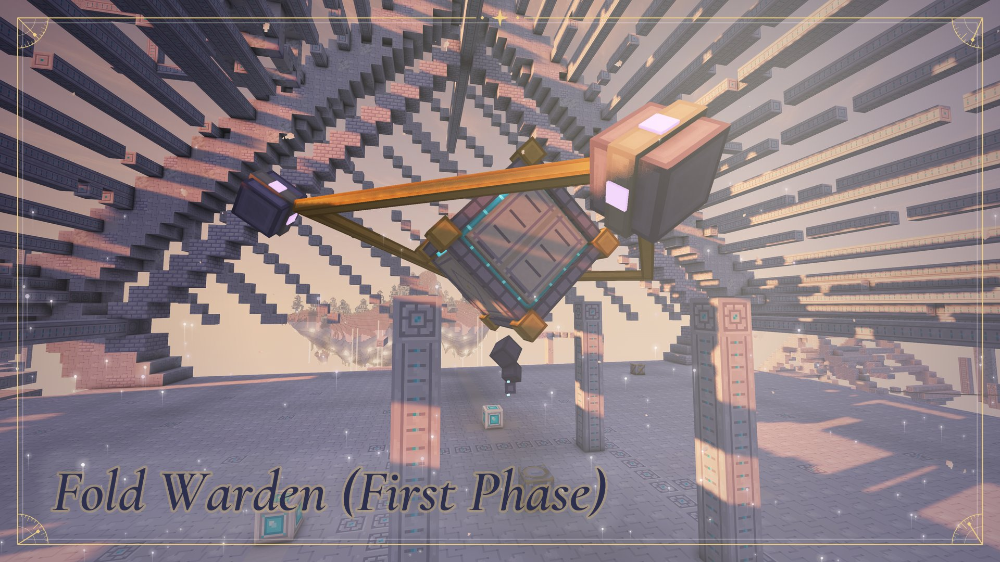 | 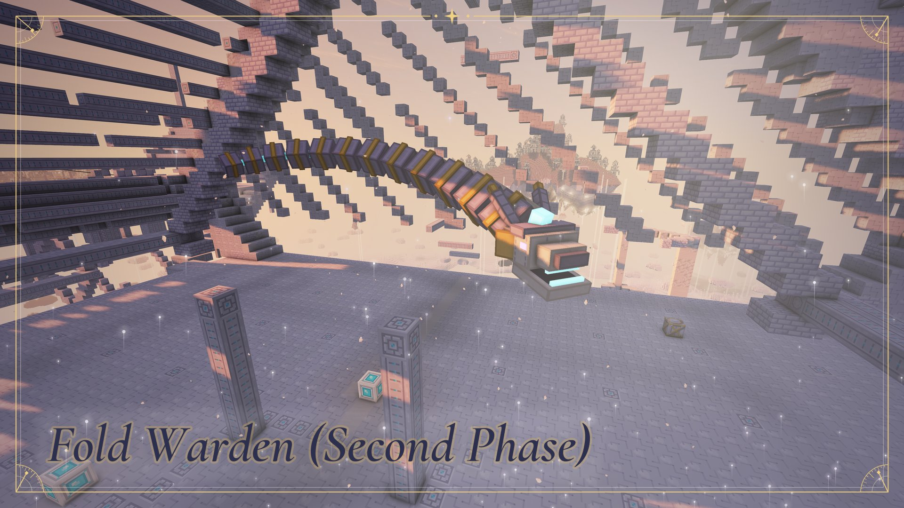 |
| **Phase 1**: a tilted cube shielded by four satellites. Break them to expose its eye; they come back after 30 seconds. | **Phase 2**: at half health it unfolds into a wyrm of twelve segments, all of them hittable. Enrages below a quarter. |

It wakes when the fourth Fold Socket of the Tilted Reliquary is filled. Attacks include sideways pushes, lift-and-slam,
boomerang tail segments, dives and a breath that cages you in lattice. Drops the Fold Anchor, the Fold Heart and Fold
Shards.

## Gear

| | |
|---|---|
|  |  |
| **Nimbusite** (tier 1): smithed from netherite. Full set: -75% fall damage. | **Levitite** (tier 2): smithed from Nimbusite. Full set: no fall damage, double jump, glide. |

* Enchantments: **Skywalker** (faster in Mist), **Uplifted** (faster updrafts), **Cloudsight** (clear vision in Mist),
  **Jumpstart** (higher jumps, Levitite boots).
* **Quantum Pedestal**: adds up to two upgrades per Levitite piece (dodge chance, knockback immunity, bouncing on Mist,
  double ore mining, shared wounds, death rewind, and more). You have to keep watching the pedestal until the
  incantation finishes.
* Utility items: Updraft Compass, Nimbus Flask (emergency cloud platform), Rewinding Hourglass, Gravity Sceptre,
  Fold Anchor, Zipline Handle and Rope.

## Kairite and machines

Kairite Ore pulses; mine it at its glow peak for a Kairite Gear, otherwise you get dust. Gears power the machines,
built at the smithing table from blueprints:

* **Pneumatic Pipes**: travel (or send items) from entrance to exit.
* **Gearlift**: elevator between gearlifts in the same column.
* **Void Tether**: catches items falling into the void.
* **Rewinder**: slowly repairs a tool.
* **Hastening Gear**: speeds up a furnace or nearby crops.
* **Phase Watch**: shows the current Chronospire phase.

## Quantum blocks

Some things only move while nobody looks at them: Flicker Shard Clusters jump around the gas cave walls, the Shifting
Vault chest relocates, the Quantum Pedestal collapses if you look away. Light or a held light source keeps them still.

## Built with

* [NeoForge](https://neoforged.net/) 21.1 (MC 1.21.1) and 26.1 (MC 26.1.2), [ModDevGradle](https://github.com/neoforged/ModDevGradle)
  and [Stonecutter](https://stonecutter.kikugie.dev/) for the multi-version build
* [Parchment](https://parchmentmc.org/) mappings (1.21.1)
* Java 21 (1.21.1) / Java 25 (26.1.2) and Gradle
* NeoForge **data generators** for every model, loot table, recipe, tag, advancement and the whole worldgen
* Minecraft's **GameTest** framework for the gameplay tests
* Paint.NET for all the textures (if you're good at pixel art, I'd love to work with you! Mine are a bit rough)

## License

Upfall is licensed under the [GNU Lesser General Public License v3.0](LICENSE) (see also [COPYING](COPYING) for the
GNU GPL v3.0 it builds upon).
