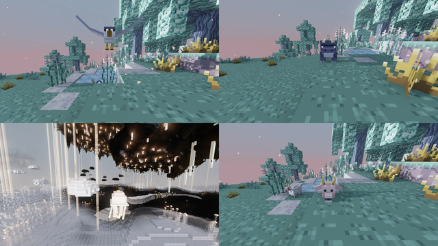

---
navigation:
  title: Creatures
  icon: upfall:cragmaw_fang
  position: 30
---

# Creatures

The Upfall is home to seven creatures, from gentle sky rays drifting in open air to the armoured Cragmaw that hunts on the islands. Most of them only exist in the Upfall dimension.

| Creature | Hostility | Where | Drops |
|---|---|---|---|
| [Cragmaw](cragmaw.md) | Hostile, attacks on sight | Islands above Y 80; Gilded Ridge, Hanging Roots, Drifting Archipelago, Rustworks | <ItemLink id="cragmaw_fang" />, Bone |
| [Duskwing](duskwing.md) | Hostile, dive-bombs | Open sky between Y 70 and 240; every biome | <ItemLink id="duskwing_plume" />, Feather |
| [Mistjelly](mistjelly.md) | Passive until hurt, then swarms | Above mist and dense cloud, Y 36 to 72; most common in the Mistsea | <ItemLink id="mist_gel" />, rarely <ItemLink id="mistglow_crystal" /> |
| [Skygrazer](skygrazer.md) | Peaceful livestock | Skygrass islands; Drifting Archipelago, Hanging Roots | <ItemLink id="raw_skygrazer_meat" />, <ItemLink id="down_tuft" /> |
| [Skyray](skyray.md) | Harmless | Open sky between Y 72 and 240; every biome except Gilded Ridge | Nothing |
| [Loftkin](loftkin.md) | Friendly trader | Cloud Hamlets | Nothing (they trade) |
| [Fold Warden](fold_warden.md) | Boss | The sealed core of a Tilted Reliquary | <ItemLink id="fold_anchor" />, <ItemLink id="fold_heart" />, <ItemLink id="fold_shard" /> |

<SubPages icons={true} />

## Spawn eggs

Every creature has a spawn egg, available in the creative inventory.

<ItemGrid>
  <ItemIcon id="cragmaw_spawn_egg" />
  <ItemIcon id="duskwing_spawn_egg" />
  <ItemIcon id="mistjelly_spawn_egg" />
  <ItemIcon id="skygrazer_spawn_egg" />
  <ItemIcon id="skyray_spawn_egg" />
  <ItemIcon id="loftkin_spawn_egg" />
  <ItemIcon id="fold_warden_spawn_egg" />
</ItemGrid>

## Related

The Drift Platform and the Zipline Pulley are also entities, but they are transport structures; see the [Structures](../structures/index.md) chapter.
