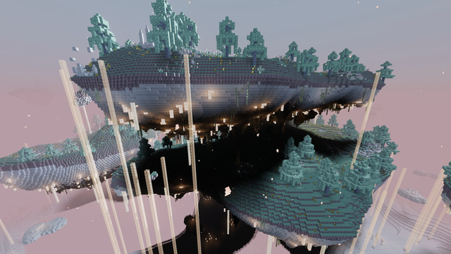

---
navigation:
  title: Sky Almanac
  icon: upfall:sky_almanac
  position: 0
item_ids:
  - upfall:sky_almanac
---

# The Sky Almanac

**The Upfall** is a sky dimension stuck in the last golden hour of the day. Archipelagos drift above a sea of
condensed clouds, whole islands hang upside down, and waterfalls pour upward into the rock. Gravity bends from one
place to the next: learning where it bends is how you get around.

It is an **endgame** destination: you reach it after the Wither and the End, arrive in netherite, and leave with two
new gear tiers, new enchantments, machines and the secrets of the sky builders.

This almanac covers everything you can find there. Hold <KeyBind id="key.guideme.guide" /> over any Upfall item
tooltip to jump straight to its page.

## Chapters

* [Getting Started](getting_started/index.md): building the Halo Portal, your first steps and the full progression.
* [The Upfall](world/index.md): biomes, the cloud sea, updrafts, cascades, gravity and gas caves.
* [Creatures](creatures/index.md): everything that flies, leaps, drifts and grazes in the sky.
* [Structures](structures/index.md): ruins, towers, villages, vaults and cities, with their puzzles and loot.
* [Materials & Equipment](materials/index.md): ores, the Nimbusite and Levitite tiers, enchantments, food and gadgets.
* [Machines & Quantum](machines/index.md): blueprints, clockwork machines, pneumatic pipes and the Quantum Pedestal.
* [Blocks & Building](blocks/index.md): stone families, woods, soils, plants and lights.

## Where to start

<Row>
  <ItemImage id="halo_frame" scale="2" />
  <ItemImage id="skyward_key" scale="2" />
</Row>

Craft <ItemLink id="halo_frame" /> blocks and a <ItemLink id="skyward_key" />, then climb above Y 200 in the
Overworld. The full walkthrough is in [Reaching the Upfall](getting_started/reaching_the_upfall.md).

## The Sky Almanac

<RecipeFor id="sky_almanac" />

Every player receives an almanac the first time they join. A lost copy can be crafted again from a book and a feather.
