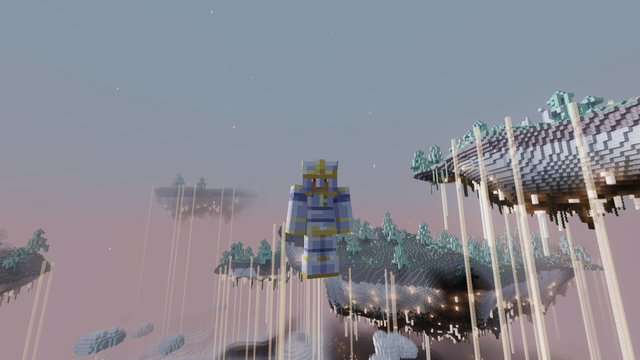

---
navigation:
  title: Levitite
  icon: upfall:levitite_ingot
  parent: materials/index.md
  position: 30
item_ids:
  - upfall:levitite_shard
  - upfall:levitite_ingot
  - upfall:levitite_block
  - upfall:levitite_upgrade_smithing_template
  - upfall:levitite_sword
  - upfall:levitite_pickaxe
  - upfall:levitite_axe
  - upfall:levitite_shovel
  - upfall:levitite_hoe
  - upfall:levitite_helmet
  - upfall:levitite_chestplate
  - upfall:levitite_leggings
  - upfall:levitite_boots
---

# Levitite

Levitite is the rarest metal of the Upfall, a violet alloy that hums with a faint glow. Its armor lets you leap twice, glide and ignore falls entirely.

<Row gap="10">
  <ItemImage id="levitite_shard" scale="3" />
  <ItemImage id="levitite_ingot" scale="3" />
  <ItemImage id="levitite_block" scale="3" />
</Row>

## Getting the metal

1. Craft or find a [Nimbusite pickaxe](nimbusite.md); nothing weaker can mine Levitite.
2. Mine [Levitite ore](ores.md) in the duskslate of the Gilded Ridge to get <ItemLink id="levitite_shard" /> (or smelt the ore for a shard).
3. Combine four shards with four <ItemLink id="nimbusite_ingot" /> in a crafting table:

<RecipeFor id="levitite_ingot" />

Nine ingots make a block, which can be turned back into ingots:

<RecipeFor id="levitite_block" />

<RecipesFor id="levitite_shard" />

## Smithing template

The <ItemLink id="levitite_upgrade_smithing_template" /> is found as loot in the Inverted Observatory (guaranteed), the Chronospire vault, the Pearl Aerie and the core of the Tilted Reliquary. See [Structures](../structures/index.md). Like its Nimbusite counterpart, a template can be duplicated: surround it with 7 Nimbusite Ingots and a block of duskslate for two copies.

<RecipeFor id="levitite_upgrade_smithing_template" />

## Equipment

Levitite gear upgrades **Nimbusite** equipment (not netherite) at a smithing table, with a Levitite Ingot as the addition.

<RecipeFor id="levitite_pickaxe" />

The same recipe applies to the <ItemLink id="levitite_sword" />, <ItemLink id="levitite_axe" />, <ItemLink id="levitite_shovel" />, <ItemLink id="levitite_hoe" />, <ItemLink id="levitite_helmet" />, <ItemLink id="levitite_chestplate" />, <ItemLink id="levitite_leggings" /> and <ItemLink id="levitite_boots" />.

### Tools

| | Netherite | Nimbusite | Levitite |
|---|---|---|---|
| Durability | 2031 | 2400 | 3000 |
| Mining speed | 9 | 10 | 11 |
| Sword damage | 8 | 9 | 10 |
| Axe damage | 10 | 11 | 12 |
| Enchantability | 15 | 16 | 18 |

### Armor

| Piece | Netherite | Nimbusite | Levitite |
|---|---|---|---|
| Helmet | 3 | 3 | 4 |
| Chestplate | 8 | 8 | 9 |
| Leggings | 6 | 7 | 7 |
| Boots | 3 | 3 | 4 |
| Toughness | 3 | 3.5 | 4 |
| Knockback resistance | 10% | 12.5% | 15% |
| Total durability | 2035 | 2420 | 3025 |

## Set bonus

Wear all four Levitite armor pieces to gain:

- **Double jump:** press <KeyBind id="key.jump" /> again in mid-air for a second boost; it carries you forward in the direction you move.
- **Glide:** hold <KeyBind id="key.jump" /> while falling to drift down slowly.
- **No fall damage:** any fall, from any height, is harmless.

Levitite Boots can also carry the [Jumpstart](enchantments.md) enchantment for even higher jumps.
