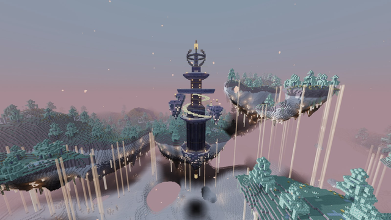

---
navigation:
  title: Chronospire
  icon: upfall:chronoglass
  parent: structures/index.md
  position: 30
item_ids:
  - upfall:chronostone
  - upfall:chronostone_bricks
  - upfall:chiseled_chronostone
  - upfall:gilded_chronostone
  - upfall:warded_chronostone
  - upfall:chronoglass
  - upfall:chronoglyph
  - upfall:chrono_gnomon
  - upfall:chrono_seal
  - upfall:glyph_pedestal
  - upfall:hour_dial
  - upfall:phase_lantern
  - upfall:phase_stone
  - upfall:phase_wheel
  - upfall:rewinding_hourglass
---

# Chronospire

A tall tower of purple chronostone growing out of a floating root of rock, with a needle spire, a golden ring gallery and a crown at the top. It keeps its own clock, and its puzzles and platforms obey that clock. Reach the vault at the top to take the <ItemLink id="rewinding_hourglass" />.

## Where to find it

- Biomes: Drifting Archipelago and Mistsea.
- Rare: spacing of about 80 chunks, so it is a landmark worth a trip.
- The whole structure is about 120 blocks tall, from its hanging root to the lantern on top of the spire. Four small floating islands, each with a pillar of phase stone and a lantern, circle the spire at a distance.

## The clock of the tower

The Chronospire follows the day of the Overworld and splits it into four **hours**, each lasting **5 minutes** (a quarter of a Minecraft day):

| Hour | Colour |
|---|---|
| Dawn | Teal |
| Noon | Gold |
| Dusk | Pink |
| Midnight | Pale blue |

The hours cycle in that order, forever. If the daylight cycle is disabled, the tower keeps counting on its own.

Read the clock with a <ItemLink id="hour_dial" />: right click it to see the current hour and the time left before the next one. Dials stand on the plaza and on the gallery. <ItemLink id="phase_lantern" /> blocks also take the colour of the current hour.

### Phase Stone

<Row gap="10">
  <BlockImage id="phase_stone" scale="3" p:phase="dawn" p:mode="solid" />
  <BlockImage id="phase_stone" scale="3" p:phase="noon" p:mode="solid" />
  <BlockImage id="phase_stone" scale="3" p:phase="dusk" p:mode="solid" />
  <BlockImage id="phase_stone" scale="3" p:phase="midnight" p:mode="solid" />
</Row>

A <ItemLink id="phase_stone" /> is only solid during **its own hour**. Outside of it, it turns into a ghost and you fall straight through. During the last 20 seconds of its hour it flickers and sheds golden dust: that is your warning.

## Drift platforms

Two **drift platforms** carry you without effort. They glide back and forth between two points, pause for about 4 seconds at each end and ease in and out. Stand on them and you are carried along.

1. The **lift** inside the tower, from the ground hall to the first chamber.
2. The **gallery platform**, from the gallery ring up and across to the crown.

Both always run, whatever the hour.

## Climbing the tower, step by step

You need no tools to climb: everything in the tower is either a puzzle or warded (indestructible).

### 1. The hall and the glyphs

On the plaza at the foot of the tower, a doorway leads into a round hall. Just inside stands a <ItemLink id="glyph_pedestal" />. In the four corners of the hall, four <ItemLink id="chronoglyph" /> blocks are set in the wall: Dawn, Noon, Dusk and Midnight. Each plays a different note when struck.

In the middle of the hall, a column of faint light is walled in by blue <ItemLink id="chrono_seal" /> blocks. The lift is behind them. The seals open when you solve the glyphs.

1. Right click the pedestal. The glyphs light up one by one, with their notes: a sequence of **5 glyphs**, never the same glyph twice in a row. Watch and listen.
2. When the show ends, the pedestal is listening. Right click the glyphs **in the same order**.
3. You have 60 seconds to hit the next glyph; the timer restarts at every correct hit. The action bar shows your progress ("Glyph 3 of 5").
4. A wrong glyph makes all four flash red and resets your progress. Right click the pedestal again to replay the sequence. The sequence is the same for a given tower, so you can note it down.
5. While the pedestal is listening, sneak and right click it to reset it.

When the last glyph rings, the seals around the lift dissolve for good. Step onto the lift and ride it up.

### 2. The wheels

The lift stops in the second chamber: a round room with five <ItemLink id="phase_wheel" /> blocks in a ring and a <ItemLink id="chrono_gnomon" /> floating in the middle. All the doors of this room are closed by seals.

<Row gap="10">
  <BlockImage id="phase_wheel" scale="3" p:phase="dawn" />
  <BlockImage id="phase_wheel" scale="3" p:phase="noon" />
  <BlockImage id="phase_wheel" scale="3" p:phase="dusk" />
  <BlockImage id="phase_wheel" scale="3" p:phase="midnight" />
  <BlockImage id="chrono_gnomon" scale="3" />
</Row>

Each wheel shows one of the four hours. The goal: make **all five wheels show the current hour of the Chronospire** (the one the gnomon and the Hour Dials show).

- Right click a wheel to advance it to the next hour in the cycle (Dawn, Noon, Dusk, Midnight, then Dawn again).
- **Each click also advances the wheel's two neighbours in the ring.** One click moves three wheels by one step.
- Right click the gnomon to be reminded of the current hour. Sneak and right click it to scramble the wheels again.
- The room checks the wheels every second against the current hour. If you align them on an hour that has not started yet, the puzzle solves itself the moment it does.

#### Solving it without trial and error

There is always exactly one solution. Only the number of clicks on each wheel counts (modulo 4: four clicks are the same as none), not their order. Number the wheels 1 to 5 around the ring, and for each wheel count how many steps forward it needs to reach the current hour: 0 if it is already right, up to 3.

Call these needs `n1` to `n5` and let `T` be their sum. The number of clicks for wheel `k` is

`(need of the wheel before it) + (need of the wheel after it) + T`, modulo 4 (4 means 0). Wheel 1 and wheel 5 are neighbours.

Example: only wheel 1 is one step short, so the needs are 1, 0, 0, 0, 0 and T = 1. Click wheel 1 once (0+0+1), wheel 2 twice (1+0+1), wheel 3 once (0+0+1), wheel 4 once (0+0+1) and wheel 5 twice (0+1+1).

If the hour changes while you work, the target changes with it: recount.

When the wheels agree with the hour, the gnomon blazes, a bell rings and the chamber's doors open. **The seals of the vault at the crown open at the same time.**

### 3. The spiral of hours

Leave the chamber by any of the four doors onto the balcony, a wide ring of cloud and bricks. Around the tower, a spiral stair of <ItemLink id="phase_stone" /> winds up about a turn and a half, rising a few blocks every quarter turn, up to the gallery 23 blocks above.

There are actually **four spirals**, one per hour, starting a quarter turn apart and interleaved. Only the one that matches the current hour is solid; the other three are ghosts.

1. Check the hour and find the spiral whose stones are solid.
2. Walk up it without stopping; the climb takes about 20 seconds, while an hour lasts 5 minutes. The best moment to start is right after the hour changes.
3. If stones start to flicker, hurry or keep going: the next hour's spiral always lies about one flight of steps below the current one. If the stone vanishes you drop a few blocks onto the next spiral and keep climbing.

A fall that goes all the way down hurts. Place blocks or use your <ItemLink id="rewinding_hourglass" /> if you have one.

### 4. The gallery and the crown

The spiral ends on the **gallery**, a ring with a dock on one side. A drift platform waits there. Ride it up and across to the **crown**.

The crown is a ring around a sealed vault, with a spire above it. Because the gnomon was solved, the vault's seals are open: walk in. In the middle of the vault stands a <ItemLink id="sky_cache" />.

## The vault loot

- **Always**: one <ItemLink id="rewinding_hourglass" />.
- A good chance of a <ItemLink id="levitite_upgrade_smithing_template" />.
- 1 to 2 enchanted books, enchanted as at levels 30 to 39.
- 4 to 6 stacks picked from: <ItemLink id="levitite_shard" />, <ItemLink id="levitite_ingot" />, <ItemLink id="nimbusite_ingot" />, diamonds, <ItemLink id="gildfruit" />, <ItemLink id="cloudberry_tart" />, <ItemLink id="mistglow_crystal" />, echo shards, <ItemLink id="phase_lantern" /> and, rarely, a <ItemLink id="hour_dial" />.

## Rewinding Hourglass

<ItemImage id="rewinding_hourglass" scale="3" float="right" />

The hourglass remembers where you stood. Right click it to be pulled back to the last solid ground you stood on **at least 3 seconds ago**, within the last 10 seconds. It also cancels your fall and your momentum.

- Recharge: 20 seconds.
- It only records your steps while it is in your inventory.
- With no ground recorded yet, it tells you the sand has nothing to remember.

 

It is perfect for the spiral, and for any long climb in the Upfall. The vault is the only source.

## Building with chronostone

Chronostone and its bricks can be mined with a pickaxe, and a few pieces are craftable. The puzzle blocks (<ItemLink id="chronoglyph" />, <ItemLink id="glyph_pedestal" />, <ItemLink id="phase_wheel" />, <ItemLink id="chrono_gnomon" />, <ItemLink id="chrono_seal" />, <ItemLink id="phase_stone" />, <ItemLink id="warded_chronostone" />, <ItemLink id="chronoglass" />) are warded: they cannot be broken or collected in survival.

<Row gap="10">
  <ItemImage id="chronostone" scale="2" />
  <ItemImage id="chronostone_bricks" scale="2" />
  <ItemImage id="chiseled_chronostone" scale="2" />
  <ItemImage id="gilded_chronostone" scale="2" />
  <ItemImage id="warded_chronostone" scale="2" />
  <ItemImage id="chronoglass" scale="2" />
</Row>

### Chronostone Bricks

<RecipeFor id="chronostone_bricks" />

### Chiseled Chronostone

Cut it from Chronostone or Chronostone Bricks in a stonecutter.

<RecipesFor id="chiseled_chronostone" />

### Gilded Chronostone

<RecipeFor id="gilded_chronostone" />

### Hour Dial

Right click to read the current hour and the time left. Handy as a clock in any base.

<RecipeFor id="hour_dial" />

### Phase Lantern

A lantern of maximum brightness that takes the colour of the current hour.

<RecipeFor id="phase_lantern" />
