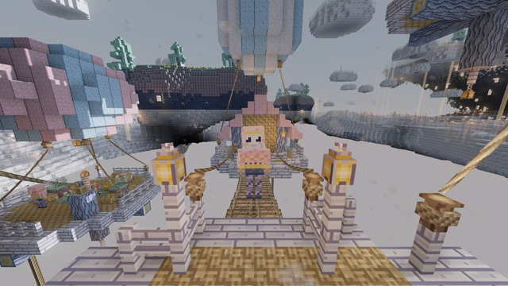

---
navigation:
  title: Cloud Hamlet
  icon: upfall:rope_anchor
  parent: structures/index.md
  position: 40
item_ids:
  - upfall:rope
  - upfall:rope_anchor
  - upfall:rope_bridge
  - upfall:rope_spool
  - upfall:zipline_anchor
  - upfall:zipline_handle
  - upfall:cloud_lantern
  - upfall:woven_planks
  - upfall:woven_slab
  - upfall:woven_stairs
---

# Cloud Hamlet

A village of wooden decks slung under colourful balloons, hovering above the cloud sea. It is home to the [Loftkin](../creatures/loftkin.md), who trade ropes, anchors and lanterns, and who built the zipline network that links their platforms.

## Where to find it

- Biomes: always in the Mistsea; occasionally (about one site in four) in the Drifting Archipelago.
- Spacing of about 28 chunks.
- It floats about 9 to 11 blocks above the top of the cloud sea. The balloons are visible from far away.

## Layout

A hamlet is made of round wooden platforms, each held up by a **balloon** and lit by hanging <ItemLink id="cloud_lantern" /> blocks.

- The **market** in the middle is the biggest platform. Canopy stalls stand on its rim.
- Up to four neighbouring platforms are joined to the market by **rope bridges**: **workshops** (a chest of rope gear) and **homes** (a chest of food and materials).
- One or two platforms are reached only by **ziplines**: a **lookout**, 9 to 13 blocks above the market, and a **garden**, 5 to 7 blocks below it.

### Loot

- Homes: food (<ItemLink id="cloudberry" />, <ItemLink id="gildfruit" />, tarts), rope, <ItemLink id="cloud_lantern" />, woven planks, canopy blocks, string, feathers, some <ItemLink id="raw_nimbusite" />, and a 15 percent chance of a <ItemLink id="zipline_handle" />.
- Workshops: a guaranteed <ItemLink id="zipline_handle" />, plus ropes, <ItemLink id="rope_anchor" /> blocks, <ItemLink id="zipline_anchor" /> blocks, <ItemLink id="rope_bridge" /> pieces, <ItemLink id="woven_planks" />, nimbusite and a <ItemLink id="rope_spool" />.

### Loftkin trades

The Loftkin sell the whole rope toolkit for cloudberries and nimbusite. Every Loftkin always offers:

- A <ItemLink id="zipline_handle" /> for 2 raw nimbusite.
- 6 <ItemLink id="rope" /> for 4 cloudberries.

and a random selection of other goods: zipline and rope anchors, cloud lanterns, woven planks, rope bridges, spools, canopy blocks, food, mistglow crystals and sometimes a nimbusite upgrade template.

## Ropes and anchors

<Row gap="10">
  <ItemImage id="rope" scale="3" />
  <ItemImage id="rope_anchor" scale="3" />
  <ItemImage id="zipline_anchor" scale="3" />
  <ItemImage id="zipline_handle" scale="3" />
</Row>

### Rope

<RecipeFor id="rope" />

<ItemLink id="rope" /> is a thin climbable line.

- **Hanging**: place it under a block or against a wall and it hangs down. You can climb it. Right click the lowest rope with more rope to extend it downward (up to 64 blocks). A rope needs a solid block above it or beside it, otherwise it falls.
- **Tying lines**: right click a <ItemLink id="rope_anchor" /> or a <ItemLink id="zipline_anchor" /> with rope in hand, then right click a second anchor of the same kind. A line is stretched between the two. Right click the same anchor again to cancel.
- The line costs **1 rope per 6 blocks of length**, rounded up (minimum 1). Creative players pay nothing.
- Breaking an anchor removes its lines.

### Rope Anchor

<RecipeFor id="rope_anchor" />

A small post that sticks to any solid face: floor, wall or ceiling. It can hold up to **4 lines**, with a maximum length of **32 blocks** each. It is decorative rope work, handy for hanging bridges or fences between buildings.

### Zipline Anchor

<RecipeFor id="zipline_anchor" />

A wooden post you place on the floor. A zipline anchor holds **a single line** and must be tied to another zipline anchor with a maximum length of **64 blocks**. Rope anchors and zipline anchors cannot be tied together. Tying a new line to a zipline anchor replaces the old one, and the two posts turn to face each other.

For a good ride, the anchor at the start should be higher than the one at the end. The line sags slightly in the middle.

### Zipline Handle

<RecipeFor id="zipline_handle" />

<ItemImage id="zipline_handle" scale="3" float="right" />

The handle is the only thing you need to ride a zipline.

1. Hold a **Zipline Handle**.
2. Right click a linked zipline anchor within about 4 blocks to hook on at the start of the line. If the anchor has no line yet, you get "No zipline within reach".
3. Or, right click while holding the handle within about 2 blocks of the line itself to latch on anywhere along it. You travel in the direction you are facing.
4. You slide automatically. You accelerate going downhill and slow down going uphill, between about 3 and 18 blocks per second.
5. Sneak to let go. If you reach the end of the line, you are released and set down gently on the platform nearby, without fall damage.

Obstacles on the line (a ceiling or a block in your way) also make you let go. A quantum upgrade can let you latch on with an empty hand.

 

## Rope Bridge

<RecipeFor id="rope_bridge" />

<ItemImage id="rope_bridge" scale="3" float="right" />

A thin deck piece, 3 pixels thick, that you can place at four heights inside a block. The height is picked by where you click on the face: click on the top face for the lowest one, or click higher up on a side face to place it higher. It rotates to run along the way you are facing, so it is easy to build long walkways in the sky or sloping bridges one quarter-block at a time.

 

## Woven Planks

<Row gap="10">
  <ItemImage id="woven_planks" scale="3" />
  <ItemImage id="woven_slab" scale="3" />
  <ItemImage id="woven_stairs" scale="3" />
</Row>

Woven planks, stairs and slabs are the basic building blocks of the hamlet. The sky-wood planks are laced with string.

<RecipeFor id="woven_planks" />

<RecipeFor id="woven_slab" />

<RecipeFor id="woven_stairs" />

Woven slabs are also the base of the <ItemLink id="rope_bridge" /> recipe.

## Cloud Lantern

<ItemImage id="cloud_lantern" scale="3" float="right" />

<RecipeFor id="cloud_lantern" />

A full-brightness lantern in a gold cage. Like a vanilla lantern, it stands on a block or hangs from the ceiling or a chain. Hamlets hang them under their platforms.

 

## Rope Spool

<ItemImage id="rope_spool" scale="3" float="right" />

<RecipeFor id="rope_spool" />

A decorative block of coiled rope around a log. It can be laid in any direction, like a log. The Loftkin use it on their decks and workshops.

 
