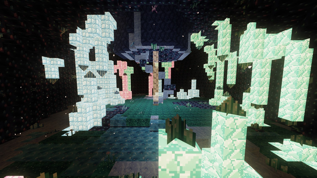

---
navigation:
  title: Crystal Grotto
  icon: upfall:azure_cluster
  parent: structures/index.md
  position: 50
item_ids:
  - upfall:lumen_druse
  - upfall:lumen_moss
  - upfall:lumen_rock
  - upfall:lumen_sprouts
  - upfall:lumen_shard
  - upfall:mistglow_dust
  - upfall:mistglow_lantern
  - upfall:moonshell
  - upfall:prism_pool
  - upfall:azure_cluster
  - upfall:rose_cluster
  - upfall:verdant_cluster
  - upfall:small_azure_bud
  - upfall:medium_azure_bud
  - upfall:large_azure_bud
  - upfall:small_rose_bud
  - upfall:medium_rose_bud
  - upfall:large_rose_bud
  - upfall:small_verdant_bud
  - upfall:medium_verdant_bud
  - upfall:large_verdant_bud
  - upfall:azure_crystal_block
  - upfall:rose_crystal_block
  - upfall:verdant_crystal_block
---

# Crystal Grotto

The Crystal Grotto is a giant geode hidden **under the cloud sea**. From above you only see a ring of glowing crystals
poking out of the clouds; below, a wide cavern lit by azure, rose and verdant crystals, with a quiet treasure at its heart.
It is one of the safest and prettiest places in the Upfall, and the main source of <ItemLink id="lumen_shard" /> and
<ItemLink id="mistglow_dust" />.

## Finding it

- Generates in the **Drifting Archipelago, Mistsea, Hanging Roots, Gilded Ridge and Rustworks** biomes, wherever the cloud
  sea is thick and level enough.
- Uncommon: roughly one grotto per region of 59 by 59 chunks.
- The geode itself is about 50 blocks wide and sits under the cloud layer. It is wrapped in a shell of
  Dense Cloud and a thin layer of Mist, so look for the crown of crystals at the top of the clouds and dive in.

## Getting in

A vertical shaft opens at the center of the crown. Inside it a **spiral stair of Moonshell and Lumen Druse** winds down to
the cavern floor, and the middle of the floor holds an **Updraft Vent** with a column of Updraft Mist rising back out of the
shaft. In other words: take the stairs down, and the vent will carry you back up.

<GameScene zoom="3" interactive={true}>
  <Block id="upfall:lumen_rock" x="0" y="0" z="0" />
  <Block id="upfall:moonshell" x="1" y="0" z="0" />
  <Block id="upfall:lumen_druse" x="2" y="0" z="0" />
  <Block id="upfall:lumen_moss" x="0" y="0" z="1" />
  <Block id="upfall:prism_pool" x="1" y="0" z="1" />
  <Block id="upfall:azure_crystal_block" x="2" y="0" z="1" />
  <Block id="upfall:azure_cluster" x="2" y="1" z="1" p:facing="up" />
  <Block id="upfall:lumen_sprouts" x="0" y="1" z="1" />
  <IsometricCamera yaw="225" pitch="30" />
</GameScene>

## The cavern

- The walls are layered: <ItemLink id="lumen_rock" /> outside, <ItemLink id="moonshell" /> in the middle and glowing
  <ItemLink id="lumen_druse" /> on the inside.
- The floor is a patchwork of <ItemLink id="lumen_moss" /> (a soft, faintly lit moss), Moonshell and Druse, with
  <ItemLink id="lumen_sprouts" /> growing on the moss.
- <ItemLink id="prism_pool" /> forms glassy, glowing pools in the floor.
- Crystal spires of one color each (**azure**, **rose** or **verdant**) rise from the floor and hang from the ceiling.
  A big cluster of spires stands about ten blocks from the center: the **heart**.
- Smaller crystals sprout from the walls everywhere, in four sizes.

## Crystals

Each color comes in the same set. The bigger the crystal, the brighter it shines.

| Block | Light |
| --- | --- |
| Crystal block (azure, rose, verdant) | 10 |
| Cluster | 11 |
| Large bud | 9 |
| Medium bud | 7 |
| Small bud | 5 |

<Row gap="10">
  <BlockImage id="azure_cluster" scale="3" />
  <BlockImage id="rose_cluster" scale="3" />
  <BlockImage id="verdant_cluster" scale="3" />
</Row>

The buds and clusters are only a decorative finish of the cavern walls: they **do not grow** over time, so mine what you
want when you find it.

- **Cluster:** mine with any pickaxe for 4 <ItemLink id="lumen_shard" /> (Fortune adds more), or 2 with another tool. Silk Touch
  keeps the cluster itself.
- **Buds:** drop nothing unless you use **Silk Touch**, which gives you the bud to place somewhere pretty.
- **Crystal blocks** need a pickaxe.

### Crafting with shards

Four Lumen Shards and a dye make the matching crystal block (light blue for azure, pink for rose, lime for verdant).

<Row gap="10">
  <RecipeFor id="azure_crystal_block" />
  <RecipeFor id="rose_crystal_block" />
  <RecipeFor id="verdant_crystal_block" />
</Row>

## Mistglow

<ItemLink id="mistglow_dust" /> comes from mining a <ItemLink id="mistglow_crystal" /> (3 to 4 dust, Fortune helps) and from
grotto chests. Four dust craft back into a Mistglow Crystal block.

The <ItemLink id="mistglow_lantern" /> shines at full light level (15). It can stand on the ground or
hang from a ceiling.

<RecipeFor id="mistglow_lantern" />

## Treasure

Two **Sky Caches** sit on the floor near the heart, one on each side of it, about 12 blocks from the center. Each one
rolls the following loot:

- **Always:** 6 to 12 Mistglow Dust, then 1 to 2 stacks of 3 to 8 Lumen Shards.
- **3 to 5 picks** among: Mistglow Crystal, Mistglow Lantern, Nimbusite Ingot, Levitite Shard, Cloudberry Tart, Gildfruit,
  Gold Ingot, Diamond, Amethyst Shard, and (rarely) an Azure, Rose or Verdant Cluster.
- **Rare bonus:** 10% for an Echo Shard (1 to 2), 4% for a <ItemLink id="levitite_ingot" />.

## Tips

- The grotto is calm: no special hazard, and the Updraft Vent saves the climb back.
- Bring a pickaxe with Silk Touch to take buds and clusters home, and a Fortune pickaxe for shards.
- Moonshell and Lumen Druse are pickaxe blocks; Lumen Moss needs a hoe to be harvested quickly.
