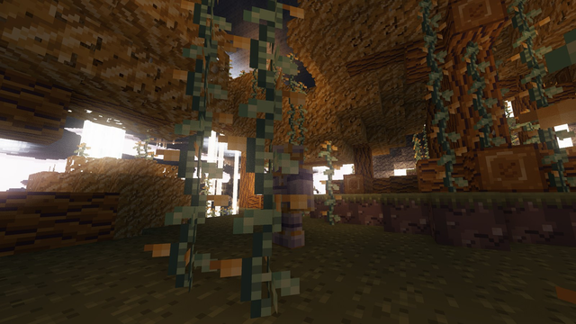

---
navigation:
  title: Gravity
  icon: upfall:levitite_ingot
  parent: world/index.md
  position: 80
---

# Gravity

Under certain islands, gravity reverses and the ceiling becomes your floor.

## The Weightless effect

**Weightless** lowers your gravity. Beneath a ceiling, gravity flips completely: you fall up and walk on it, upside down. Sneak to let go.

You receive Weightless automatically in the **Weightless zones**: under the inverted islands of the [Hanging Roots](hanging_roots.md), wherever a solid block lies within about 28 blocks above you. Other ways to become Weightless are covered below.

## Walking on the ceiling

- While Weightless, the solid block above you (within 24 blocks) pulls you up.
- You can walk and jump on it normally; a jump sends you away from the ceiling.
- Sneaking, swimming, creative flight and gliding release you.
- When you let go, you get a few seconds of Slow Falling so you can land safely.

## Gear

The <ItemLink id="gravity_sceptre" /> grants Weightless on demand. See also the <ItemLink id="levitite_ingot" /> gear and the Quantum Pedestal upgrades in [Machines & Quantum](../machines/index.md).
