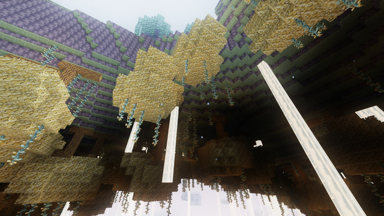

---
navigation:
  title: Hanging Roots
  icon: upfall:gildroot_log
  parent: world/index.md
  position: 30
---

# Hanging Roots

Inverted islands: the grass grows on the **underside** and the forest hangs downward into the sky.

## Terrain

The islands' grass faces down, with Skysoil behind it. Dense curtains of Glowvines and Upfall Cascades hang and rise around them. Beneath these islands you are in a **Weightless zone**: your gravity flips and you can walk on the ceiling. See [Gravity](gravity.md).

## What you find

- **Gildroot trees** growing downward, plus sparse Skyreach trees.
- **Dense Glowvines and Upfall Cascades**, more than in other biomes.
- **Gilded Tufts, Cloud Ferns, Duskblooms** and Cloudstalks.
- **Ores**: <ItemLink id="nimbusite_ore" /> and <ItemLink id="pearled_cloud" />.
- **Structure**: the Inverted Observatory. See [Structures](../structures/index.md).

## Creatures

Skygrazers (fewer than in the Archipelago), Skyrays, Mistjellies, Cragmaws and Duskwings.
